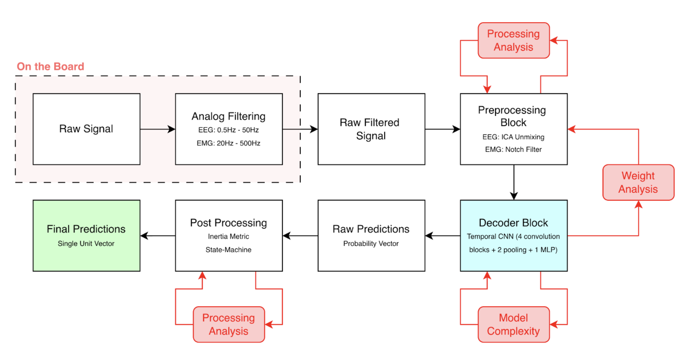

# Design Solution Definition: EEG Decoding Pipeline

> **Project:** EEG Decoder V1
> **Document ID:** `DSD-001-EEG-DECODING`
> **Version:** `0.1.0` · **Status:** `Draft`
> **Project phase:** `Proof of Concept`
> **Last modified:** `2026-10-23`
> **Repository path:** `docs/DSD_Template.md`

---

## Document control

### Roles and sign-off

| Role | Name | Affiliation / Handle | Date | Signature / Review link |
|---|---|---|---|---|
| Author(s) | Guilherme Costa-Ferreira | TL / `GuilhermeCF` | | |
| Reviewer (technical) | `<TBD>` | | | |
| Concurrence (SE Reviewer) | `<TBD>` | | | |
| Concurrence (Quality management reviewer) | `<TBD>` | | | |
| Approval (Project Manager) | `<TBD>` | | | |

> Note : Link approval to any relevant PR (Pull Request)
> Affiliation/Handle : Role/ Username on Github

### Modification log

| Version | Date | Author(s) | Main changes | PR / Commit |
|---|---|---|---|---|
| 0.1.0 | 2026-10-23 | Guilherme Costa-Ferreira | First draft filled from repository state (`docs/sdr` branch) and the TCNN + dataset adaptation PR under review | `ebca441` |

---

## Table of contents

1. [Introduction](#1-introduction)
2. [Requirements and traceability](#2-requirements-and-traceability)
3. [Concept justification](#3-concept-justification)
4. [Traded-off concepts](#4-traded-off-concepts)
5. [Quality management and compliance](#5-quality-management-and-compliance) /!\ THIS SECTION IS NOT FINALISED /!\
6. [Licensing](#6-licensing) /!\ THIS SECTION IS NOT FINALISED /!\
7. [Open issues and future work](#7-open-issues-and-future-work)
8. [References](#8-references)
9. [Appendices](#9-appendices)

---

## 1. Introduction

### 1.1 Purpose and scope

This Design Solution Definition (DSD) is at a `Proof of concept` stage
validated on `<date>`. It justifies the concept selected for the `EEG decoding pipeline V1`.

It covers:

- the problem the subsystem must solve
- the retained concept: architecture, components, and design choices
- the concepts that were considered and not retained
- risks, quality, and compliance implications.

**Out of scope:**
- EEG acquisition hardware (dry electrodes, analog front-end, ADC board) - covered by the EEG Hardware team.
- EMG decoding and prosthesis actuation/control - on their own [EMG Repository](https://github.com/N-Pulse/BMI-SOFT-EMG-Decoding)
- Movement (gesture) decoding from EEG - dropped for V1, see 4.2.1.
- Exploratory models never integrated and previous research (`archives/2024/`, `scripts/svm/`, `scripts/treeoftrees/`).

### 1.2 Responsibility and change authority

- **Document owner:** Guilherme Costa-Ferreira, Decoding Team
- **Change authority:** Decoding TL (repository maintainer). Changes are proposed through meetings and then merged through a reviewed pull request into `main`, following `.github/pull_request_template.md`.

### 1.3 Abbreviated terms and definitions

| Term | Definition |
|---|---|
| DSD | Design Solution Definition |
| EEG | Electroencephalography |
| Gel / wet EEG | EEG recorded with gel electrodes (open-source and local datasets) |
| Dry EEG | EEG recorded with gel-free electrodes, as on the N-Pulse headset: higher impedance, more drift and motion artefacts |
| Movement intention | Detection of the user's intention to move (vs rest), before or at movement onset |
| Movement decoding | Classification of which movement is performed (dropped for V1) |
| MOVING | Open-source gel EEG dataset of upper-limb movements |
| BIDS | Brain Imaging Data Structure, used for the in-house archive |
| XDF | Extensible Data Format (LSL recordings from the in-house acquisition) |
| SVM | Support Vector Machine |
| CNN | Convolutional neural network |
| TCNN | Temporal CNN, the V1 model based on Atzori et al. (2016) |
| TTV | Train / Test / Validation split |
| ICA | Independent Component Analysis |
| κ (kappa) | Cohen's kappa score, agreement corrected for chance |
| MAKE Archive | In-house storage for recordings and trained models |

## 2. Requirements and traceability

| Requirement ID | Description (derived) | Verification method | Status |
|---|---|---|---|
| REQ-SW-001 | The pipeline shall ingest in-house recordings (XDF → BIDS, MAKE Archive) and the MOVING open-source dataset through a single download/load interface. | D | met (`src/download/`) |
| REQ-SW-002 | The decoder shall detect movement intention (intention vs rest vs presence of movement). | T | not met |
| REQ-SW-003 | The decoder should be tested on windows of 50-200 ms | T | not met |
| REQ-SW-004 | Input data shall only contain the hardware channels: C1, C2, C3, C4, C5, C6, Cz, FC1, FC2, FC3, FC4, CP1, CP2, CPz (ref FCz, ground AFz). | I | met in PR review |
| REQ-SW-005 | Training data shall be adapted to the deployment acquisition domain (board resolution and sampling rate, first-order 0.5–45 Hz analogue filter). | T | met in PR review |
| REQ-SW-006 | Training data should reproduce the noise of dry electrodes. | A, T | not met |
| REQ-SW-007 | Evaluation shall be subject-disjoint (70/15/15 split balanced by participant and movement). | I, T | met in PR review |
| REQ-SW-008 | Evaluation shall report accuracy, Cohen's kappa and F1 score. | T | partial (`scripts/evaluation/`) |
| REQ-SW-009 | The model and preprocessing should be reducible to run on the board (sampling rate, window, channels, quantisation). | A | not met |
| REQ-SW-010 | Experiments shall be reproducible from config files with fixed seeds. | I | partial |
| REQ-SW-011 | Only reviewed and refactored code should live in `src/`, the rest shall live in `scripts/`. | D | partial |
| REQ-SW-012 | The model should outperform the exploratory SVM and TreeOfTrees baselines (testing only, never integrated). | D | not met |

> **Verification methods:** (D)emonstration, (T)est, (M)easurement, (I)nspection, (A)nalysis

---

## 3. Concept justification

The design aims at a decoder that is (1) able to detect movement intention from 14 dry EEG channels, (2) cheap enough to run on a low-compute chip, and (3) trainable today on gel EEG while the in-house dry dataset does not exist yet. Every element below follows from those three constraints.

### 3.1 Solution overview

This is the first integrated EEG decoder (V1). Before it, hand-crafted features with classical classifiers (SVM, TreeOfTrees) were only used for exploratory testing and were never integrated; they performed close to chance. The main concept for V1 is an **end-to-end Temporal CNN (TCNN)** based on Atzori et al. (2016), trained on a **merged open-source (MOVING) and local dataset adapted to the headset's acquisition domain**. The task is narrowed to **movement intention**: movement decoding performs poorly in the literature even with more channels and better signal quality, and our exploratory SVM and TreeOfTrees tests confirmed it. Because our headset uses dry electrodes and all available training data is gel EEG, the adaptation will be **upgraded with a dry-electrode noise model** learned from open-source dry EEG. The model is first evaluated as a raw baseline (150 ms windows, no software preprocessing), then improved through a controlled preprocessing study (re-referencing, ICA), and finally **reduced for the embedded target** following Wang et al. (2020). In parallel, a **science track** studies the learned CNN filters.

*Figure 3.1: High-level architecture of the EEG decoding pipeline V1*

### 3.2 Main design choices

#### 3.2.1 Movement intention as the only decoding task

- **Decision:** V1 only decodes movement intention. Movement (gesture) decoding is dropped.
- **Rationale:** Movement decoding from non-invasive EEG reaches poor accuracy in the literature even with high channel counts and gel electrodes. Our exploratory SVM and TreeOfTrees tests on MOVING (never integrated) scored close to random. With 14 dry channels the problem would be harder still. Intention detection is better supported in the literature and is the most useful output for the prosthesis (e.g. as a trigger combined with EMG).
- **Requirements addressed:** REQ-SW-002
- **Consequences / limitations:** The EEG decoder no longer selects the movement; that role stays with EMG. Labels must be redefined around movement onset (intention window vs rest), which changes the TTV split balancing.

#### 3.2.2 Temporal CNN (Atzori et al. 2016) as the V1 model

- **Decision:** Implement in PyTorch the five-block CNN of Atzori et al. (2016), the same architecture as the EMG V2 decoder, with the input adapted to 14 EEG channels.
- **Rationale:** It is simple and well documented, shared with the EMG team (one codebase and reduction pipeline to maintain), and small enough for later embedded reduction. Learning features from the signal removes the hand-crafted features that failed in the exploratory tests. It is the starting point for a more complex and tailored approach.
- **Requirements addressed:** REQ-SW-002, REQ-SW-012
- **Consequences / limitations:** Adds PyTorch to the environment (version constraints to be reported, see OI-01). The architecture was designed for EMG, not for EEG spectral content, so baseline performance is expected to be modest.

#### 3.2.3 Dataset adaptation to the deployment domain

- **Decision:** Merge the MOVING and local datasets and adapt them to look like what the headset will deliver: channel selection to the 14 hardware electrodes (dropping channels in the local set, interpolating missing ones in MOVING), amplitude scaling and signal resolution to the board ADC, sampling frequency (down/up-sampling) and a simulated first-order 0.5–45 Hz analogue filter. Under review in the TCNN + dataset adaptation PR.
- **Rationale:** No dry-headset data exists yet; training on adapted gel data lets the model learn while staying in the board's numeric domain.
- **Requirements addressed:** REQ-SW-004, REQ-SW-005
- **Consequences / limitations:** Interpolated channels are smoother than recorded ones. The adaptation does not cover the gel-to-dry difference, which motivates 3.2.4.

#### 3.2.4 Dry-electrode noise modelling (planned upgrade)

- **Decision:** Model the noise of dry electrodes and inject it into the adapted gel data.
- **Rationale:** Open-source dry EEG datasets are too incomplete to train on (missing channels of our montage, different tasks, few subjects), but they are enough to characterise dry-electrode noise: higher and varying impedance, low-frequency drift, motion and contact artefacts, and a higher noise floor. Gel data keeps the task-related signal; the noise model makes it resemble what the headset records.
- **Requirements addressed:** REQ-SW-006
- **Consequences / limitations:** The noise model is an approximation and must be validated on headset recordings once available (spectral comparison and accuracy on real dry data). Noise parameters become dataset hyperparameters.

#### 3.2.5 Train/Test/Val split 70/15/15 balanced by user and movement

- **Decision:** One TTV split of 70 % / 15 % / 15 %, disjoint by participant and balanced per movement. The train set is ~80 % open-source / 20 % local; validation and test lean towards local data. The deliverable is the split file itself.
- **Rationale:** The decoder must generalise to unseen users. Local data is closer to deployment, so it should weigh more in evaluation; headset data will take its place as it arrives.
- **Requirements addressed:** REQ-SW-007, REQ-SW-010
- **Consequences / limitations:** The local dataset is small, so val/test may end up with few subjects or imperfect balance.

#### 3.2.6 Raw baseline at a locked 150 ms window

- **Decision:** Before any preprocessing or tuning, train and evaluate the TCNN on 150 ms windows, reporting accuracy, Cohen's kappa and F1 score. Trained models are saved to the MAKE Archive and their paths recorded; training curves and model size are reported alongside.
- **Rationale:** Establishes raw model capacity. 150 ms is not yet a realistic window, but fixing it isolates the effect of the model from the effect of window length.
- **Requirements addressed:** REQ-SW-003, REQ-SW-008, REQ-SW-012
- **Consequences / limitations:** Performance is expected to be low at this stage; it is the reference for every later step.

#### 3.2.7 Preprocessing study (re-referencing + ICA)

- **Decision:** Re-reference the data, then run ICA. The main noise sources (blinks, heart rate) are identified and their unmixing matrices applied just before the model. This is the base of the preprocessing pipeline, evaluated at the locked 150 ms window.
- **Rationale:** EEG has a much lower signal-to-noise ratio than EMG; removing ocular and cardiac components is standard and expected to bring the largest gain.
- **Requirements addressed:** REQ-SW-008, REQ-SW-009
- **Consequences / limitations:** Fixed unmixing matrices may not transfer between users or sessions, and ICA on 14 dry channels separates fewer sources. Each step costs compute on the board, so it must earn its place by a measured gain.

#### 3.2.8 Model reduction for the embedded target (Wang et al. 2020)

- **Decision:** Apply the Wang et al. (2020) reduction pipeline step by step, measuring the impact of each step:
  1. reduce the sampling rate where possible,
  2. reduce the window size: grid search over 50, 75, 100, 150, 175 and 200 ms,
  3. silence the least important channels,
  4. quantise the weights.
  A robustness score summarising performance across realistic window sizes is defined for this evaluation.
- **Rationale:** Larger windows are expected to perform better, but real-time control needs short windows. The pipeline is proven for EEGNet on low-power MCUs, on an EEG task.
- **Requirements addressed:** REQ-SW-003, REQ-SW-009
- **Consequences / limitations:** Each reduction may lose accuracy

#### 3.2.9 Science track: CNN interpretability

- **Decision:** Analyse the learned CNN weights, starting from the first and last layers (expected to be the most interpretable, by analogy with vision CNNs), form hypotheses on their role and verify them with ablation studies, following Fraternali et al. (2026). Architecture changes inspired by Liao et al. (2025) are also explored.
- **Rationale:** Understanding what the model learned guides better architectures and helps transfer knowledge between terms.
- **Requirements addressed:** REQ-SW-012
- **Consequences / limitations:** Experimental, with no guaranteed outcome. Requires a structured documentation base and a literature database. Close to the end of the semester, we might fail to complete it.

#### 3.2.10 Workflow stages

| Mode / Stage | Purpose | Entry condition | Exit condition | Documentation deliverables |
|---|---|---|---|---|
| 2.1 TCNN implementation | Reproduce Atzori et al. (2016) in PyTorch | PyTorch added to the environment | Runs without crashing on dummy data, on all team computers | Python and package version constraints |
| 2.2 Dataset adaptation | Merge MOVING + local data into the headset domain and build the TTV split | Data downloaded (`scripts/download/`) | Adapted data and 70/15/15 split file exist | Dataset composition per partition and overall size; signal similarity open-source vs local per task; electrode maps before/after pruning |
| 2.2b Dry-noise model | Make gel data resemble dry-electrode data | 2.2 done, dry dataset selected | Noise model validated on spectra | Noise characterisation plots, gel vs dry vs adapted comparison |
| 2.3 Training and evaluation | Raw intention baseline at 150 ms | Split file and working TCNN | Baseline accuracy, kappa, F1 reported | Models saved at MAKE Archive (paths); metric plots, training curves, model size |
| 2.4 Preprocessing | Measure the effect of re-referencing and ICA | Baseline available | Retained preprocessing chain chosen | Same as 2.3, plus ICA maps and source analysis |
| 2.5 Science | Interpret the CNN filters and test architecture changes | Trained TCNN available | Hypotheses confirmed or rejected by ablation | Structured docs base and literature database |
| 2.6 Optimisation | Reduce the model for the board | Retained preprocessing chain | Reduced model fits the board | Same as 2.3 for each step; window-size grid and robustness score |

### 3.3 Functionally linked systems

- **In-house EEG acquisition hardware** (dry-electrode headset): defines channels, reference, resolution, sampling rate and the 0.5–45 Hz first-order filter that the adaptation mimics.
- **Embedded firmware** (developed by the EEG team, as for EMG): will host the reduced model from step 2.6.
- **MAKE Archive**: source of local recordings and storage for trained models.
- **MOVING dataset**: main training data. **Open-source dry EEG datasets**: noise modelling only.
- **Exploratory baselines** (SVM, TreeOfTrees in `scripts/`): testing only, never integrated; the reference V1 must outperform (REQ-SW-012).
- **EMG decoding**: shares the TCNN and the reduction pipeline. EEG intention may later gate EMG gesture decoding through a state machine.

### 3.4 Performance budgets and design margins

| Budget | Target | Current estimate / value | Source |
|---|---|---|---|
| Inference latency | `<TBD>` | Not measured | Step 2.6 |
| Window size | Realistic window (50–200 ms tested) | Locked at 150 ms until step 2.6 | V1 plan |
| Channels | ≤ 14 | 14 | Hardware montage |
| Flash / SRAM | `<TBD: target MCU>` | Not measured; reduced by channel silencing and quantisation | Target MCU datasheet |

> Budgets will be filled with measured values at step 2.6 (OI-06).

---

## 4. Traded-off concepts

### 4.1 Trade-off method

The trade-off method used was based on the following criteria :
- Meets performance requirements (accuracy, kappa, F1 on the subject-disjoint split)
- Embedded feasibility (memory, compute, latency after reduction)
- Potential to outperform the exploratory baselines and to be improved (REQ-SW-012, science track)
- Data efficiency (works with adapted gel data and few dry recordings)
- Development effort and tooling maturity
- Maintainability

| Criterion | Weight (1 - 5) | Rationale for weight |
|---|---|---|
| Meets performance requirements | 5 | The exploratory SVM / TreeOfTrees tests were close to chance; the decoder must first show it can learn anything reliable across subjects. |
| Embedded feasibility | 4 | The model must eventually run on the board, but the reduction pipeline gives room to shrink it. |
| Potential to outperform baselines | 4 | V1 must beat the exploratory baselines and open a research path. |
| Data efficiency | 4 | No dry-headset data and small local datasets; data is a stronger constraint than for EMG. |
| Development effort | 3 | Student team with limited time per semester. |
| Maintainability | 2 | Useful for handover between terms, not critical at PoC stage. |

Score scale :
> [1] : Does not meet any requirements
> [2] : Meets some requirements
> [3] : Meets all minimum requirements 'Shall' requirements
> [4] : Meets all minimum requirements and 'should'
> [5] : Meets all requirements, 'Shall, should & may'

> Scores are qualitative at this stage and will be updated with measured results from steps 2.3–2.6 (OI-07). Max score = 5 × (5+4+4+4+3+2) = 110.

### 4.2 Traded-off design choices

#### 4.2.1 Alternative A: Movement decoding task

- **Description:** Classify which upper-limb movement is performed (as in the MOVING labels), instead of only detecting intention.
- **Pros:** Richer output; would let EEG control the prosthesis alone.
- **Cons:** Poor accuracy reported in the literature even with high channel counts and gel electrodes. Our exploratory SVM and TreeOfTrees tests on this task were close to random. With 14 dry channels it would be harder still. Not a realistic target for a proof of concept.

| Criterion | Weight (1-5) | score (1-5) |
|---|---|---|
| Meets performance requirements | 5 | 1 |
| Embedded feasibility | 4 | 3 |
| Potential to outperform baselines | 4 | 2 |
| Data efficiency | 4 | 1 |
| Development effort | 3 | 3 |
| Maintainability | 2 | 3 |
| ---|---|---|
|Total Score| 50 | max score : 110 |

#### 4.2.2 Alternative B: Feature-based SVM / TreeOfTrees (exploratory, never integrated)

- **Description:** Hand-crafted band-power and frequency features (theta to gamma bands, total power, mean, median and peak frequency) fed to an SVM or to the TreeOfTrees (one binary tree per movement in cascade).
- **Pros:** Small, fast to train, interpretable, already implemented in `scripts/svm/` and `scripts/treeoftrees/`.
- **Cons:** Close to chance on MOVING. Band power needs long windows to be stable, which conflicts with short windows. Little room for research improvement. These models were only used for testing and never integrated; they are kept as the baseline to beat until we have a CNN baseline.

| Criterion | Weight (1-5) | score (1-5) |
|---|---|---|
| Meets performance requirements | 5 | 1 |
| Embedded feasibility | 4 | 4 |
| Potential to outperform baselines | 4 | 1 |
| Data efficiency | 4 | 4 |
| Development effort | 3 | 5 |
| Maintainability | 2 | 4 |
| ---|---|---|
|Total Score| 68 | max score : 110 |

#### 4.2.3 Alternative C: Remodelled / larger architectures

- **Description:** EEG-specific or attention-based architectures (EEGNet, TCN by Bai et al. 2018, composite attention CNN by Liao et al. 2025).
- **Pros:** Closer to the state of the art, with chances of better classification metrics.
- **Cons:** Starting from a complex architecture would lock us into a copy from the literature we would not have the intuition to improve. More data-hungry, which is our main constraint, and harder to fit on the board. Using the same TCNN as EMG keeps one codebase. These architectures are kept for the science track.

| Criterion | Weight (1-5) | score (1-5) |
|---|---|---|
| Meets performance requirements | 5 | 4 |
| Embedded feasibility | 4 | 2 |
| Potential to outperform baselines | 4 | 3 |
| Data efficiency | 4 | 2 |
| Development effort | 3 | 2 |
| Maintainability | 2 | 2 |
| ---|---|---|
|Total Score| 62 | max score : 110 |

#### 4.2.4 Alternative D: Training data without dry-noise modelling

- **Description:** (i) adapted gel data only, (ii) open-source dry EEG as training data, or (iii) waiting for headset recordings.
- **Pros:** (i) no extra work; (ii) closest noise to the headset; (iii) exact deployment domain.
- **Cons:** (i) gel-to-dry gap left open, so offline accuracy may not transfer; (ii) dry datasets too incomplete to train on; (iii) blocks all model work until the headset is ready and gives a very small dataset.

#### 4.2.5 Retained: Intention TCNN on adapted gel data + dry-noise model, with Wang et al. (2020) reduction

- **Pros:** Task supported by the literature; simple, reducible model shared with EMG; uses all available data while approaching the headset domain; first and last layers open to interpretation.
- **Cons:** Less interpretable than feature-based models; adds PyTorch; the noise model is unvalidated until headset data exists; baseline performance expected to be modest before preprocessing.

| Criterion | Weight (1-5) | score (1-5) |
|---|---|---|
| Meets performance requirements | 5 | 3 |
| Embedded feasibility | 4 | 4 |
| Potential to outperform baselines | 4 | 4 |
| Data efficiency | 4 | 3 |
| Development effort | 3 | 4 |
| Maintainability | 2 | 4 |
| ---|---|---|
|Total Score| 79 | max score : 110 |

### 4.3 Trade-off summary

| Option | Score | Retained | Key reason |
|---|---|---|---|
| Intention TCNN + adapted data + dry noise + Wang reduction | 79 | Yes | Feasible task, simple reducible model shared with EMG, closest data to the headset |
| SVM / TreeOfTrees (exploratory) | 68 | No (baseline) | Testing only, never integrated; close to chance |
| Remodelled / larger architectures | 62 | No (science track) | Too data-hungry and heavy for our first deep model |
| Movement decoding task | 50 | No | Poor literature results and near-random exploratory results |
| Training data without dry-noise model | n/a | No | Gel-to-dry gap, incomplete dry data, or blocked development |

## 5. Quality management and compliance

**WORK IN PROGRESS**

Current status: research-use only (RUO) proof of concept; no clinical use. Good-practice measures in place: PR and issue templates, reviewed merges into `main`. Tests still to be added (`tests/README.md`).

## 6. Licensing

**WORK IN PROGRESS**

## 7. Open issues and future work

| ID | Issue / TBD / TBC | Owner | Due | Impact if unresolved |
|---|---|---|---|---|
| OI-01 | Merge the TCNN + dataset adaptation PR and report Python / PyTorch version constraints | EEG team | TBD | Results not reproducible across machines |
| OI-02 | Redefine labels for movement intention (intention window vs rest) and rebalance the TTV split | EEG team | TBD | REQ-SW-002 cannot be tested |
| OI-03 | Select an open-source dry EEG dataset and build the dry-noise model | EEG team | TBD | Model may not transfer to the headset |
| OI-04 | Confirm board resolution, sampling rate and scaling with the hardware team | EEG team / Hardware | TBD | Wrong adaptation parameters |
| OI-05 | Quantify signal similarity between open-source and local recordings; produce electrode maps | EEG team | TBD | Domain gap unknown |
| OI-06 | Measure latency and memory of the reduced model on the target board | EEG team | TBD | REQ-SW-009 unverified |
| OI-07 | Update chapter 4 scores with measured accuracy, kappa and F1 | EEG team | TBD | Trade-off stays qualitative |
| OI-08 | Define the window-size robustness score used in step 2.6 | EEG team | TBD | Window choice not justified |
| OI-09 | Set up the structured docs base and literature database for the science track | EEG team | TBD | Findings lost between terms |

---

## 8. References

1. Applicable documents: project requirements specification `<TBD>`; EEG V1 plan (internal); [`src/download/README.md`](../src/download/README.md).
2. Reference documents:
   - Atzori, M., Cognolato, M., & Müller, H. (2016). Deep learning with convolutional neural networks applied to electromyography data: A resource for the classification of movements for prosthetic hands. *Frontiers in Neurorobotics*, 10. https://doi.org/10.3389/fnbot.2016.00009
   - Fraternali, M., Magosso, E., & Borra, D. (2026). Inferring arm movement direction from EEG signals using explainable deep learning. *Sensors*, 26(4), 1235. https://doi.org/10.3390/s26041235
   - Liao, W., Miao, Z., Liang, S., Zhang, L., & Li, C. (2025). A composite improved attention convolutional network for motor imagery EEG classification. *Frontiers in Neuroscience*, 19. https://doi.org/10.3389/fnins.2025.1543508
   - Wang, X., Hersche, M., Tömekce, B., Kaya, B., Magno, M., & Benini, L. (2020). An accurate EEGNet-based motor-imagery brain-computer interface for low-power edge computing. arXiv:2004.00077. https://doi.org/10.1109/MeMeA49120.2020.9137134
   - Bai, S., Kolter, J. Z., & Koltun, V. (2018). An empirical evaluation of generic convolutional and recurrent networks for sequence modeling. arXiv:1803.01271. https://arxiv.org/abs/1803.01271
   - MOVING dataset `<full reference TBD>`.
   - Open-source dry EEG dataset `<TBD>`.
   - PyTorch documentation.

---

## 9. Appendices

### Appendix A: Bill of materials

Software-only subsystem: no hardware BOM. Dependencies are listed in [`requirements.txt`](../requirements.txt).

### Appendix B: Hardware montage

- Measurement electrodes: C1, C2, C3, C4, C5, C6, Cz, FC1, FC2, FC3, FC4, CP1, CP2, CPz
- Reference: FCz
- Ground: AFz
